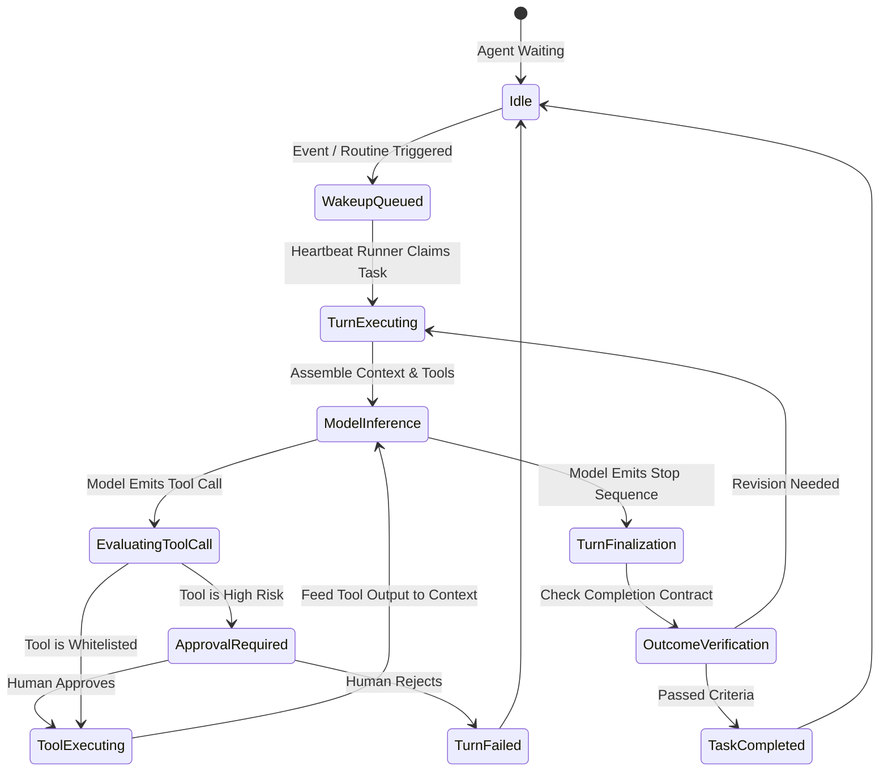

# Geetorus — Agent Lifecycle & Task Workflows

## 1. Agent Runtime Architecture

Each virtual agent in Geetorus operates as a stateful entity defined by:
1. **Agent Profile (`agents.ts`)**: Identity, title, system instructions, and reporting relationships.
2. **Model Binding (`ai_connection_defaults.ts`)**: Designates foundation provider, model name, temperature, and token caps.
3. **Assigned Tool Whitelist (`tool_access.ts`)**: Granular bindings to specific MCP servers and authorized methods.
4. **Budget Policy (`budget_policies.ts`)**: Daily and per-task dollar/token limits.

---

## 2. Heartbeat & Turn Execution Loop

---

## 3. Completion Contracts & Outcome Enforcement

Geetorus enforces **Completion Contracts (`completion_contracts.ts`)**. A task is not marked completed simply because an LLM says it is finished. The engine verifies:
1. **File Modification Check**: Expected output files or git diffs exist in the execution workspace.
2. **Test Suite Verification**: Test runners report zero exit codes.
3. **Artifact Registration**: Generated assets (docs, pull requests, builds) are stored in `issue_work_products.ts`.
