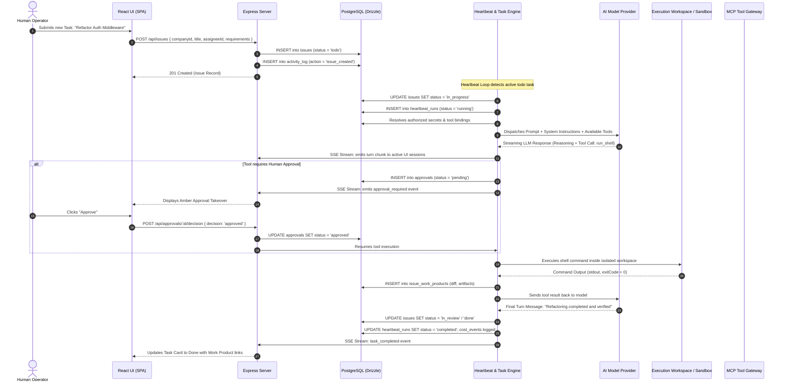

# Geetorus — Data Flow & Event Lifecycle

This document traces the complete end-to-end data flow from user interaction to agent turn execution, tool invocation, and outcome verification.

---

## 1. End-to-End Task Execution Flow

---

## 2. Event Dispatch & Real-Time Streaming

Geetorus employs **Server-Sent Events (SSE)** for zero-overhead, real-time streaming from the server to connected UI clients:

- `/api/issues/:id/live`: Streams raw turn-by-turn thinking blocks, tool invocations, and command stdout.
- `/api/activity/stream`: Global tenant-wide activity stream for live operator situational awareness.
- `/api/heartbeats/live`: Live heartbeat state indicators across all agents in the virtual company.
