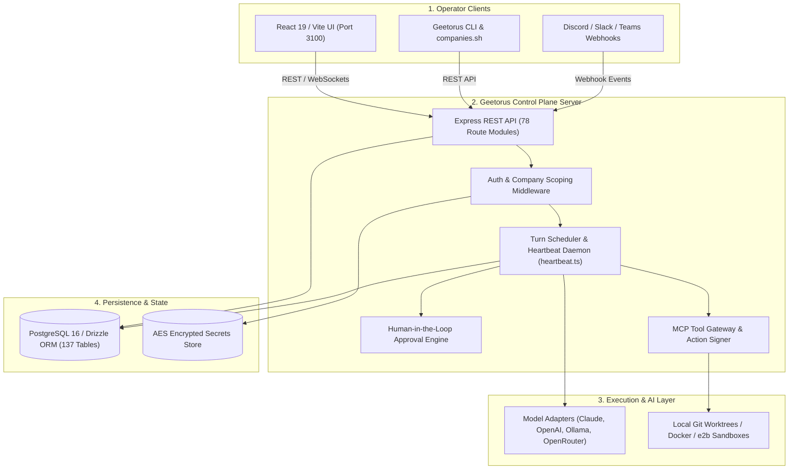
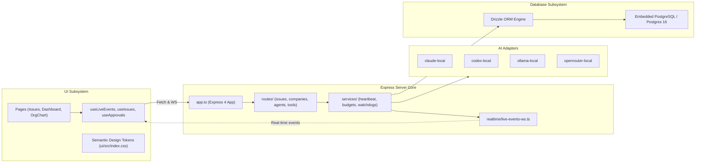
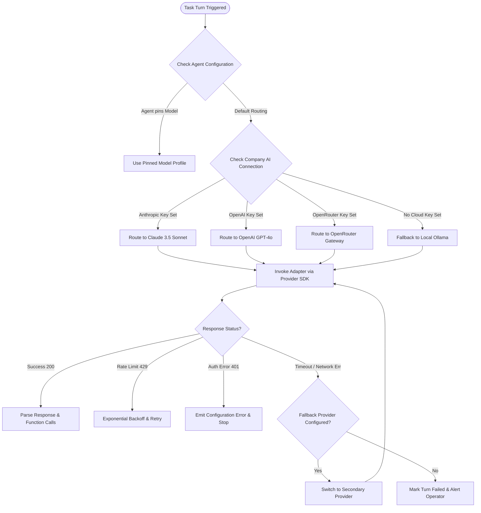
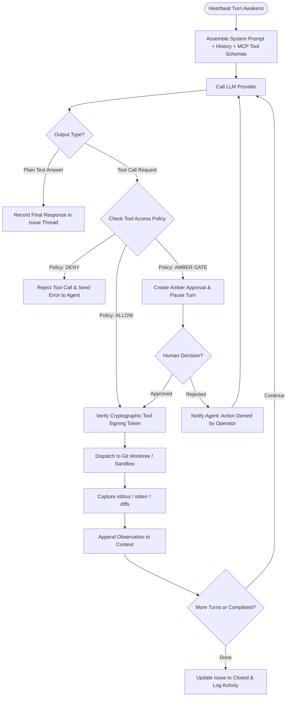
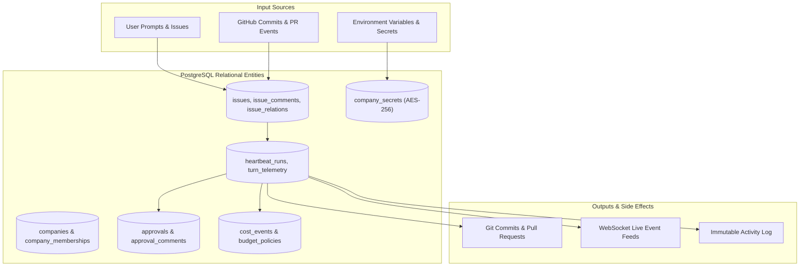
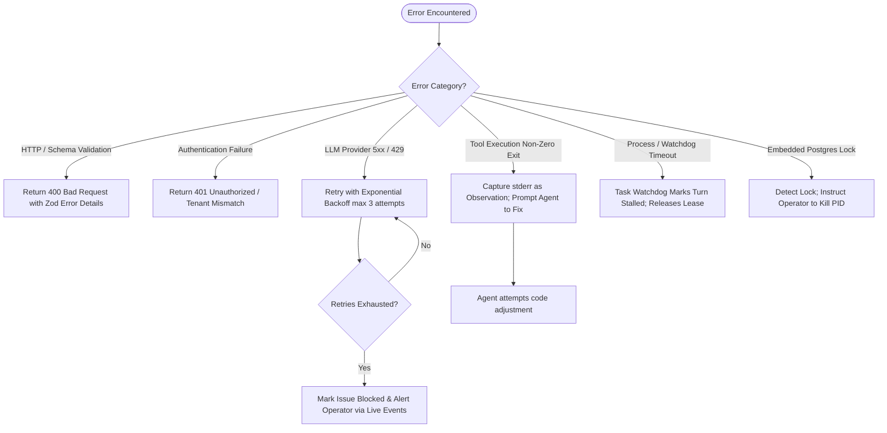
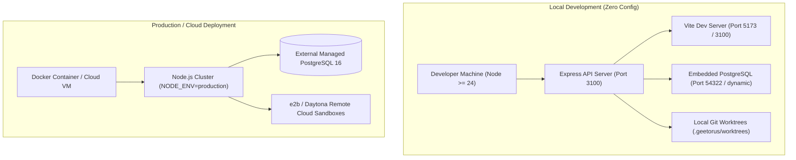
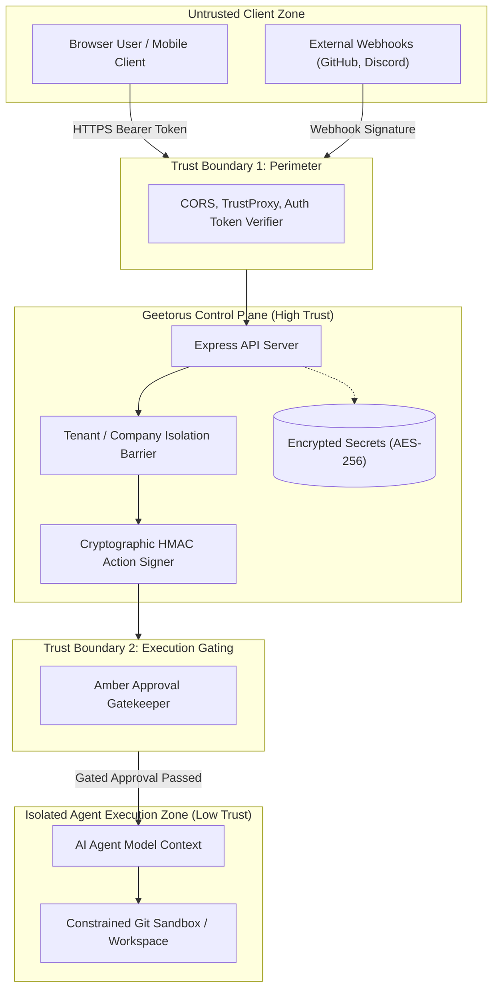

# 04 — Complete System Architecture Diagrams (Mermaid)

> **Target Venue**: AURVEXX’2026 Hackathon  
> **Visual Format**: Validated GitHub-flavored Mermaid diagrams  
> **Explanation Format**: Dual-Language (Simple Professional English + Founder-Friendly Thanglish)

---

## Diagram A: High-Level System Architecture



### Step-by-Step Explanation
* **English**: The Operator initiates tasks via the React UI, CLI, or Chat Bridges (Slack/Discord). Requests hit Express API routes guarded by tenant-isolation middleware. The Heartbeat Daemon schedules turns, queries the Model Adapter, routes required tools through the MCP Tool Gateway, enforces human approvals if sensitive actions are requested, and commits execution state to PostgreSQL.
* **Thanglish**: *Namma user UI-la iruntho illa CLI-la iruntho task create pannuvanga. Request direct-ah Express API-kku pogum. Anga tenant check panni, Heartbeat Runner turn start pannum. LLM-kitta kettu tool call execute panna MCP Gateway vazhiya safe sandbox-la run aagum. Crucial actions iruntha human approval ketkum. Ella data-vum 137 tables ulla PostgreSQL DB-la safe-ah save aagum.*

---

## Diagram B: Detailed Component Architecture



### Step-by-Step Explanation
* **English**: Shows the exact internal wiring: React Pages consume custom hooks connected to Express routes and the WebSocket live event stream. Server services invoke AI Adapters and persist data via Drizzle ORM.
* **Thanglish**: *Frontend pages hooks vazhiya backend API-kooda pesum. Real-time updates WebSocket live-events stream vazhiya instantly display aagum. Server services AI adapter-ah call panni result-ah Drizzle ORM moolama database-la update pannum.*

---

## Diagram C: Request Lifecycle Sequence Diagram

```mermaid
sequenceDiagram
    autonumber
    actor Operator as Human Operator
    participant UI as React 19 Frontend
    participant API as Express Router (/api/issues)
    participant HB as Heartbeat Daemon (heartbeat.ts)
    participant LLM as AI Model Adapter (Claude/OpenAI)
    participant GW as MCP Tool Gateway
    participant DB as PostgreSQL (Drizzle)

    Operator->>UI: Submit New Issue ("Fix Auth Bug")
    UI->>API: POST /api/issues { title, companyId, priority }
    API->>DB: Insert issue record (status: 'open')
    API-->>UI: 201 Created (Issue #101)
    Note over HB: Heartbeat Poller detects runnable issue
    HB->>DB: Acquire execution lease & set status 'in_progress'
    HB->>LLM: Generate plan with system prompt + issue context
    LLM-->>HB: Tool Call Requested: "git_checkout_branch"
    HB->>GW: Dispatch tool execution intent
    GW->>GW: Check policy: Is action gated?
    alt Action is Safe (Read-only)
        GW-->>HB: Execute immediately & return stdout
    else Action requires Human Approval (Amber Gate)
        GW->>DB: Create Approval Request (status: 'pending')
        GW-->>HB: Pause turn; wait for operator decision
        HB->>UI: Emit Live Event (WS: "Approval Needed")
        Operator->>UI: Click "Approve Action"
        UI->>API: POST /api/approvals/12/decide { decision: 'approved' }
        API->>DB: Update approval record
        API->>HB: Wake up paused heartbeat turn
        HB->>GW: Resume execution in sandbox
    end

    HB->>DB: Write turn logs, token costs, and work products
    HB->>DB: Update issue status to 'completed'
    HB->>UI: Emit Live Event ("Issue Completed")
```

### Step-by-Step Explanation
* **English**: Traces a complete user request from creation through heartbeat dispatch, LLM tool generation, approval gating, sandbox execution, and final database status update.
* **Thanglish**: *Operator issue submit panna udane DB-la insert aagum. Heartbeat engine athai pick panni lease edukum. LLM tool run panna solrapo, athu dangerous action-ah iruntha 'Amber Gate' approval request create panni pause pannum. User UI-la approve pannona turn resume aagi, sandbox-la code execute panni issue complete aagum.*

---

## Diagram D: AI Model Routing Flowchart



### Step-by-Step Explanation
* **English**: Illustrates how Geetorus inspects company-level and agent-level configurations to select between Anthropic, OpenAI, OpenRouter, and local Ollama, handling rate limits with backoff and attempting fallback providers if configured.
* **Thanglish**: *Task start aagum pothu, agent config check pannum. Anthropic, OpenAI, OpenRouter or local Ollama ethu available-nu pathu route pannum. Rate limit vantha exponential backoff panni retry pannum. Fallback model iruntha athuku switch pannum.*

---

## Diagram E: Agent and Tool Execution Flowchart



### Step-by-Step Explanation
* **English**: Shows the complete inner agent loop: prompt assembly, model reasoning, policy verification (Deny, Amber Gate, Allow), cryptographic token verification, sandbox execution, and feedback ingestion into subsequent turns.
* **Thanglish**: *Agent prompt ready panni model kitta pogum. Model tool execute panna sonna, policy check nadakum. Amber gate na human approve panra varaikum wait pannum. Verify aana apram sandbox-la run panni, output-ah thirumba agent context-ku feedback-ah anupum.*

---

## Diagram F: Data Flow Diagram



### Step-by-Step Explanation
* **English**: Demonstrates data lineage: user issues and webhook events flow into relational tables, drive heartbeat turns, record budget costs and approvals, and generate git commits and live WebSocket updates.
* **Thanglish**: *Input data issues table-ku pogum, secrets encrypted-ah store aagum. Turn execute aagura apo cost events, approvals, git commits nu ovvoru data layer-um systematically update aagum.*

---

## Diagram G: Error Handling Flowchart



### Step-by-Step Explanation
* **English**: Details how the system handles validation errors, auth mismatches, LLM rate limits/outages, tool execution failures, watchdog turn timeouts, and embedded database process locks.
* **Thanglish**: *Error vantha category pathu handle pannum: Validation na 400, LLM outage na 3 times backoff retry, tool fail aana stderr-ah agent-kitteye kuduthu thirumba fix panna sollum. Stalled aana watchdog lease release panni alert pannum.*

---

## Diagram H: Deployment Architecture



### Step-by-Step Explanation
* **English**: Compares the zero-configuration local development mode (using embedded PostgreSQL and local git worktrees) with the production deployment mode (using external managed PostgreSQL and cloud execution sandboxes).
* **Thanglish**: *Local-la run panna extra software ethuvum thevailla—Node.js mattum pothum, embedded Postgres thanave launch aagirum. Production-la external PostgreSQL matrum Docker/e2b cloud sandboxes use pannalam.*

---

## Diagram I: Trust Boundaries and Security Diagram



### Step-by-Step Explanation
* **English**: Highlights the dual security perimeters: Perimeter 1 validates incoming HTTP traffic, tokens, and company multi-tenancy. Perimeter 2 sits between the AI Agent reasoning engine and actual code execution, preventing untrusted LLM outputs from running arbitrary commands without cryptographic signing and human approval.
* **Thanglish**: *Rendu security walls iruku: First wall incoming user tokens and company access-ah check pannum. Second wall AI agent-kum execute aagura code-kum naduvula iruku. Agent ethavathu dangerous command pota, human approval illama run panna mudiyathu.*
