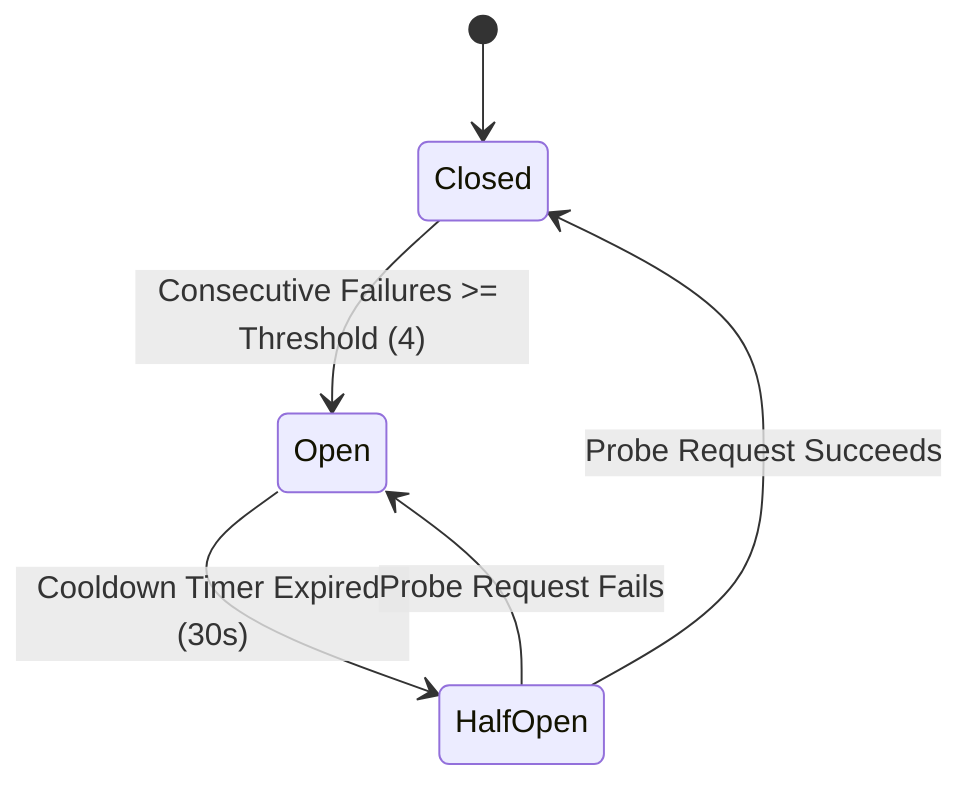

# GeetorusAI Self-Healing System Specification

## 1. Principles of Self-Healing

The self-healing architecture of GeetorusAI operates under strict SRE and security constraints:
1. **Never retry blindly**: Unrecoverable failures (e.g., bad API keys, permission denials, invalid syntax) must fail immediately without generating retry storms.
2. **Never leak secrets in diagnostics**: Error traces presented to operators or users must have credentials, tokens, and authorization headers redacted.
3. **Deterministic fallbacks**: Moving to a backup model or service requires explicit compatibility, matching capabilities, and policy authorization.
4. **Never loop infinitely**: All retries are bounded by count and maximum timeout durations.

---

## 2. Failure Detection & Error Classification

Error classification is governed by `classifyError()` in `server/src/services/self-healing/error-classifier.ts`.

| HTTP Status / Pattern | Classification | Recoverable? | Default Action |
| :--- | :--- | :--- | :--- |
| `429`, Quota Exceeded | `rate_limit` | Yes | Respect `Retry-After` header or exponential backoff + jitter. |
| `401`, Invalid API Key | `auth` | No | Halt retries immediately. Prompt operator to update credentials. |
| `403`, Forbidden | `permission` | No | Halt retries. Flag missing organization or model entitlement. |
| `ETIMEDOUT`, Timeout | `timeout` | Yes | Bounded retry with backoff. If exhausted, trip circuit breaker. |
| `ECONNRESET`, Net Reset | `network` | Yes | Exponential backoff retry. |
| `404`, Model Not Found | `unsupported_model` | Conditioned | If fallback model configured, route to fallback; else fail cleanly. |
| `5xx`, Server Error | `server_error` | Yes | Bounded retry; increment provider failure counter. |
| Malformed Response | `invalid_input` | No | Log diagnostic structure and halt to avoid corrupt state. |

---

## 3. Circuit Breakers

Circuit breakers safeguard against cascading upstream outages. They are implemented in `server/src/services/self-healing/circuit-breaker.ts`.

### 3.1 State Transitions


### 3.2 Breaker Properties
- **Threshold**: Default `4` consecutive errors.
- **Cooldown**: Default `30,000ms`.
- **Manual Override**: Operators can reset any circuit breaker via the **Pulse Center** UI or `POST /api/pulse/circuit-breakers/:provider/reset`.

---

## 4. Recovery Execution Engine

The recovery engine (`server/src/services/self-healing/recovery-engine.ts`) executes operations wrapped in the self-healing pipeline:

```typescript
export interface RecoveryExecutionOptions<T> {
  component: string;
  provider?: string;
  model?: string;
  fallbackModel?: string;
  maxRetries?: number;
  baseDelayMs?: number;
  maxDelayMs?: number;
  abortSignal?: AbortSignal;
  execute: (attempt: number, currentModel?: string) => Promise<T>;
  onFallback?: (failedModel: string, targetModel: string) => void;
}
```

### 4.1 Exponential Backoff with Jitter
Backoff calculations compute:
$$Delay = \min(MaxDelay, BaseDelay \times 2^{attempt - 1}) \times Jitter$$
Where $Jitter \in [0.75, 1.25]$. This mitigates thundering herd problems when upstream endpoints recover.

### 4.2 Fallback Routing
When a model query fails due to deprecation or provider disruption, the recovery engine inspects `fallbackModel`. If provided and distinct from the primary, the engine executes the task on the fallback and emits an `onFallback` telemetry event for operator auditing.
