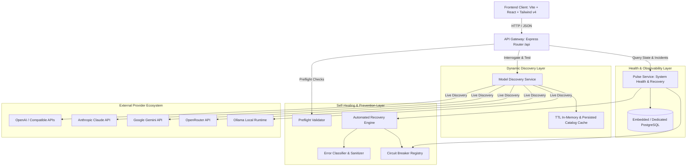

# GeetorusAI System Architecture: Self-Healing & Model Discovery

## 1. Executive Summary

This document specifies the updated architecture of **GeetorusAI**, transforming it from a traditional AI control plane into an intelligent, self-healing, model-discovering, and error-preventing platform with a distinctive minimal interface and selective brutalist operational aesthetics.

GeetorusAI operates as a high-reliability AI agent and workflow orchestrator. Rather than relying on fragile hardcoded model lists or crashing on transient provider glitches, GeetorusAI incorporates:
- **Centralized Error Classification & Telemetry**: Every error is sanitized, categorized into structured taxonomy, and tagged with correlation IDs.
- **Circuit Breaker Registry**: Fault tolerance across AI providers preventing cascade failures.
- **Automated Recovery Pipeline**: Exponential backoff with full jitter, `Retry-After` protocol conformance, and deterministic fallback routing.
- **Dynamic Model Discovery Engine**: Live model catalog interrogation from official provider APIs (OpenAI, Anthropic, Google Gemini, OpenRouter, and Ollama) with normalized metadata.
- **Proactive Error Prevention**: Preflight payload, token context, and SSRF verification.
- **Pulse — System Health & Recovery**: The unified operational observability center replacing legacy "Heartbeat" terminology.

---

## 2. Component Architecture & Integration Boundaries

---

## 3. Core Modules & Responsibilities

### 3.1 Shared Types Package (`@geetorusai/shared`)
- **Location**: `packages/shared/src/types/self-healing.ts`
- **Responsibilities**: Defines immutable types across server and client boundaries:
  - `ErrorCategory`: `timeout`, `network`, `auth`, `permission`, `rate_limit`, `server_error`, `unsupported_model`, `invalid_input`, `payload_too_large`, `circuit_broken`, `database`, `unknown`.
  - `ErrorSeverity`: `critical`, `high`, `medium`, `low`, `info`.
  - `HealthState`: `healthy`, `degraded`, `unavailable`, `recovering`, `unknown`.
  - `CircuitBreakerStatus`: `serviceId`, `state`, `failures`, `threshold`, `cooldownMs`.
  - `DiscoveredModel`: Normalized schema for model capabilities, context windows, and status.
  - `PulseSystemStatus`: Aggregated health record of all system services and active incidents.

### 3.2 Error Classifier & Sanitizer
- **Location**: `server/src/services/self-healing/error-classifier.ts`
- **Responsibilities**:
  - Intercepts raw exceptions from network clients, SDKs, and local services.
  - Sanitizes sensitive tokens, API keys (`sk-...`), and Bearer auth headers using regex redactions.
  - Inspects HTTP status codes (`401`, `403`, `429`, `5xx`) and standard error message conventions.
  - Determines recoverability (`recoverable: boolean`) to protect against endless retry loops on permanent failures.

### 3.3 Circuit Breaker Registry
- **Location**: `server/src/services/self-healing/circuit-breaker.ts`
- **Responsibilities**:
  - State machine per provider/service: `closed` -> `open` -> `half_open`.
  - Tracks consecutive failures against a configurable threshold (default: 4).
  - Enforces cooldown timers (default: 30,000ms) during which incoming requests are halted before hitting degraded upstream APIs.

### 3.4 Recovery Engine
- **Location**: `server/src/services/self-healing/recovery-engine.ts`
- **Responsibilities**:
  - Implements bounded retries with exponential backoff and randomized jitter (`0.75x` to `1.25x`).
  - Respects HTTP `Retry-After` headers if returned by the upstream provider.
  - Facilitates policy-governed fallback model routing when a primary model encounters deprecation or temporary unavailability.
  - Records an append-only circular audit log of all recovery operations.

### 3.5 Dynamic Model Discovery Service
- **Location**: `server/src/services/model-discovery/model-discovery-service.ts`
- **Responsibilities**:
  - Direct integration with official model endpoints:
    - OpenAI: `GET /v1/models`
    - Anthropic: `GET /v1/models`
    - Google Gemini: `GET /v1beta/models`
    - OpenRouter: `GET /api/v1/models`
    - Ollama: `GET /api/tags`
  - Normalizes heterogeneous provider formats into a unified `DiscoveredModel` contract.
  - Tracks context window capacities, output token limits, tool-calling flags, and vision support.
  - Provides connection testing with live latency measurement.

### 3.6 Pulse Service
- **Location**: `server/src/services/pulse/pulse-service.ts`
- **Responsibilities**:
  - Aggregates operational status from PostgreSQL, API endpoints, circuit breakers, and recovery events.
  - Manages incident lifecycle (detection, observation, manual/auto-resolution).
  - User-facing renaming anchor replacing legacy "Heartbeat" terminology with **Pulse — System Health & Recovery**.
