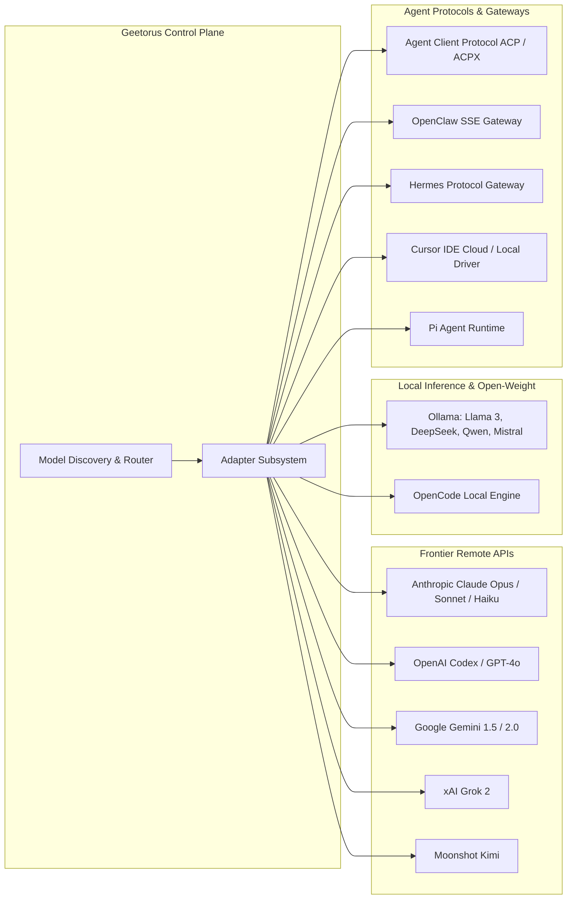
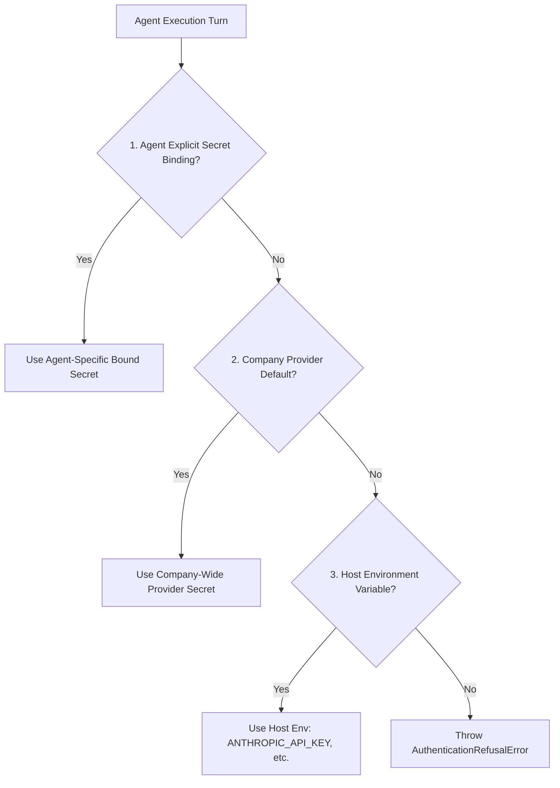

# 07 — AI Models and Provider Connectivity

GeetorusAI features a pluggable, model-agnostic provider subsystem designed to decouple agent reasoning logic from specific AI vendors. The platform supports **13 distinct provider adapters** spanning frontier remote APIs, local open-weight runtimes, and standardized agent-client protocols.

---

## 1. Supported Model Providers & Adapters

---

## 2. Comprehensive Adapter Inventory

| Adapter Type | Display Label | Supported Protocols | Default Model | Primary Package |
| :--- | :--- | :--- | :--- | :--- |
| `claude_local` | Claude Code | ACP / CLI | `claude-opus-5` | `packages/adapters/claude-local` |
| `codex_local` | OpenAI Codex | ACP / Stdio | `codex-davinci` | `packages/adapters/codex-local` |
| `gemini_local` | Google Gemini | REST / Stdio | `gemini-2.0-flash` | `packages/adapters/gemini-local` |
| `grok_local` | xAI Grok | REST / OpenAI-compat | `grok-2` | `packages/adapters/grok-local` |
| `ollama_local` | Ollama Local | HTTP / REST | `llama3.3:70b` | `packages/adapters/ollama-local` |
| `openclaw_gateway` | OpenClaw Gateway | SSE / WebSocket | `openclaw-default` | `packages/adapters/openclaw-gateway` |
| `hermes_gateway` | Hermes Gateway | JSON-RPC / Gateway | `hermes-agent-v1` | `packages/adapters/hermes-gateway` |
| `cursor_local` | Cursor Local | IPC / Stdio | `cursor-fast` | `packages/adapters/cursor-local` |
| `cursor_cloud` | Cursor Cloud | HTTPS / Token | `cursor-cloud-v1` | `packages/adapters/cursor-cloud` |
| `kimi_local` | Moonshot Kimi | REST / OpenAI-compat | `moonshot-v1-128k` | `packages/adapters/kimi-local` |
| `opencode_local`| OpenCode | CLI / Stdio | `opencode-default` | `packages/adapters/opencode-local` |
| `pi_local` | Pi Local | Stdio / JSON | `pi-default` | `packages/adapters/pi-local` |

---

## 3. Protocol Implementations: ACP vs. CLI

### 1. Agent Client Protocol (ACP / ACPX)
- **Used by**: `claude_local`, `codex_local`.
- **Implementation**: Managed subprocess sidecar (`geetorus-runner-acpx-sidecar`) communicating via bidirectional JSON-RPC over `stdio`.
- **Advantages**: Persistent session states, warm process reuse (`warmHandleIdleMs`), fine-grained tool streaming, and native permission negotations.

### 2. Standard CLI Subprocess
- **Used by**: Claude CLI, OpenCode, Ollama, Pi.
- **Implementation**: Spawns isolated OS binaries (`claude`, `ollama`, `opencode`) inside ephemeral working directories with runtime environment variable injection (`ANTHROPIC_API_KEY`, `OPENAI_API_KEY`, etc.).

---

## 4. Credential Resolution & Secret Binding

GeetorusAI enforces zero-hardcoded secrets. Provider credentials resolve dynamically at runtime using a strict precedence hierarchy:

---

## 5. Streaming, Tool Calling & Fallback Policies

- **Token Streaming**: Real-time token output chunks are captured from ACP/stdio stdout and forwarded via WebSocket to the UI live terminal.
- **Tool Calling**:
  - Claude & Codex ACP use native structured tool calling via JSON schemas.
  - CLI adapters receive specialized system prompt wrappers rendering available MCP tools.
- **Circuit Breakers & Retries**:
  - `ErrorClassifier` categorizes failures as `network`, `rate_limit`, `auth`, `context_overflow`, or `fatal`.
  - Rate limits trigger exponential backoff with randomized jitter (e.g. 500ms -> 1500ms -> 4500ms).
  - Sustained failures trip the provider circuit breaker, automatically routing subsequent tasks to pre-configured fallback models (e.g., Claude Opus -> Claude Sonnet).
