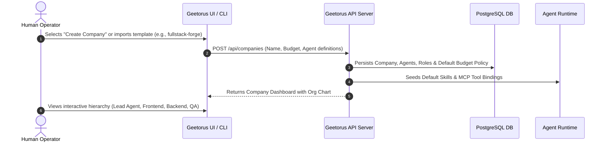
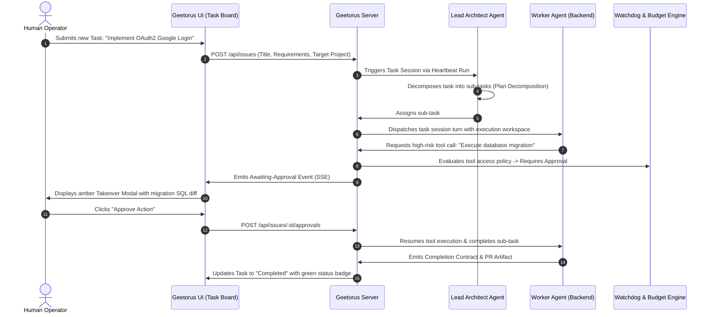

# Geetorus — Personas, Workflows & Use Cases

## 1. User Personas

### Persona A: The AI-First Technical Founder (Alex)
- **Profile**: Solo founder or technical co-founder building a high-velocity SaaS startup.
- **Goals**: Wants a full engineering team (Backend Engineer, Frontend Engineer, QA Reviewer, DevOps) running autonomously on backlog issues.
- **Needs in Geetorus**:
  - Out-of-the-box company templates (`fullstack-forge`, `clawteam-engineering`).
  - Budget caps ($50/day hard stop) to protect runway.
  - Automatic PR creation and branch management in GitHub.
  - Interactive web UI to inspect agent diffs, approve merges, and unblock stalled agents.

### Persona B: The Engineering Manager / Platform Lead (Priya)
- **Profile**: Manages a team of 15 human engineers at a mid-market tech company.
- **Goals**: Automate maintenance, dependency updates, test flakiness fixes, and security patch reviews without context-switching human engineers.
- **Needs in Geetorus**:
  - Scheduled routines running nightly.
  - Sandboxed execution environments (e2b, Daytona) to ensure agent builds do not touch production infrastructure.
  - Granular MCP tool permissions (read-only git access for junior agents; write access gated by human approval).
  - Multi-user authentication with role-based access control.

### Persona C: The Digital Agency Operator (Marcus)
- **Profile**: Operates an AI-driven digital marketing and content agency serving 20+ clients.
- **Goals**: Maintain isolated virtual companies per client, equipped with client-specific brand voices, social media tools, and analytics MCP connections.
- **Needs in Geetorus**:
  - Multi-tenancy with strict company isolation in PostgreSQL.
  - CLI import/export via `companies.sh` to replicate proven agency team topologies across client workspaces.
  - Client-scoped secret management and budget allocations.

---

## 2. Core User Journeys & Workflows

### Journey 1: Company Initialization & Agent Onboarding


### Journey 2: Task Execution, Delegation & Human Approval


### Journey 3: Self-Healing & Automatic Run Recovery
```mermaid
flowchart TD
    A[Agent Task Session Starts] --> B[Execute Model Inference & Tool Call]
    B --> C{Execution Status?}
    C -->|Success| D[Verify Completion Contract]
    C -->|API Timeout / Rate Limit| E[Watchdog Detects Stall]
    C -->|Invalid Tool Output| F[Agent Turn Error]
    
    E --> G{Retry Policy Available?}
    F --> G
    
    G -->|Yes (Retries < Max)| H[Dispatch Recovery Action / Safe Turn Restart]
    H --> B
    
    G -->|No (Exceeded)| I[Transition Task to 'Blocked']
    I --> J[Post Diagnostic Summary to Task Feed]
    J --> K[Notify Operator for Intervention]
    
    D -->|Passed| L[Task Marked Completed]
    D -->|Failed Criteria| M[Re-queue with Feedback Injection]
    M --> B
```
